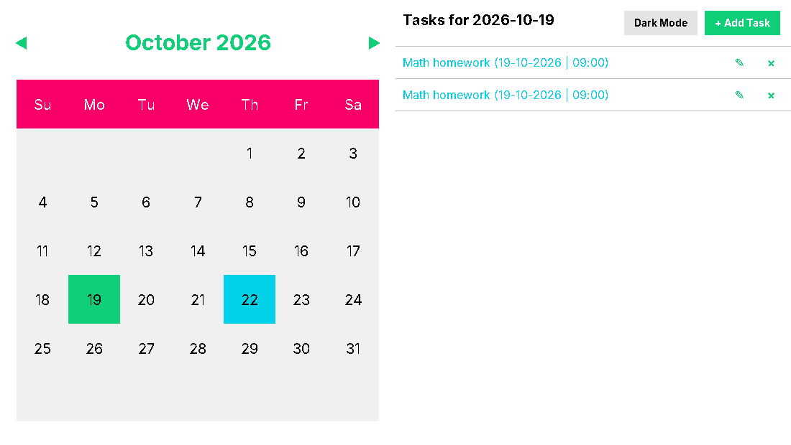
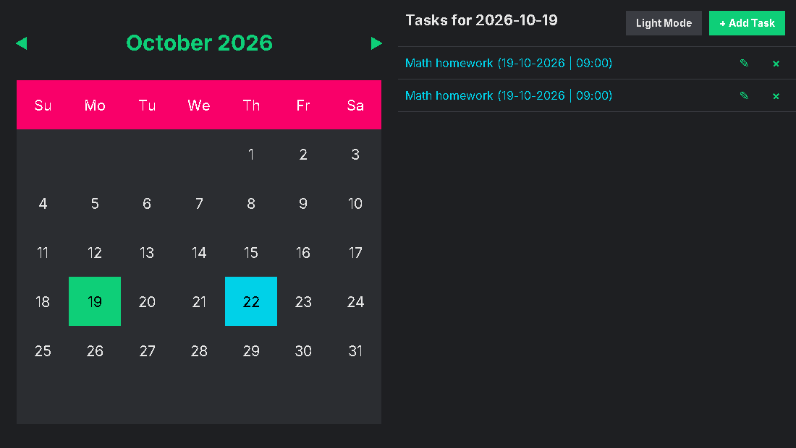

# 📅 MyCalendar

A desktop calendar and task manager built with **Java Swing**. It runs on **Windows, macOS and Linux**. Browse months, click any day, and manage tasks with titles, times and descriptions. Everything is saved automatically between sessions, including whether you prefer **Light Mode** or **Dark Mode**.

| Light Mode | Dark Mode |
|:---:|:---:|
|  |  |

The app has two panels: a **monthly calendar** on the left and a **task list** on the right. The selected day is highlighted in green, and any day that already has tasks is highlighted in teal, so you can see your schedule at a glance. Clicking a day updates the task panel, where you can add, edit or delete tasks for that date.

---

## Features

- **Light Mode / Dark Mode toggle**: one click switches the whole app. The choice is stored in `calendar_data.ser` with your tasks, so the app opens in the mode you last used
- **One-command install from the terminal** on Windows, macOS and Linux
- **Automatic updates**: the app checks for a new version each time it starts and installs it with one click, keeping your calendar
- **Cross-platform**: native installers for Windows, macOS (Apple Silicon and Intel) and Linux (any distro), plus a plain `.jar` for any system with Java
- **Monthly calendar view** with previous/next month buttons
- **Per-day task panel** listing that day's tasks in time order
- **Add, edit and delete tasks** in a modal editor (title, time, description). Enter saves and Esc cancels
- **Visual indicators**: days with tasks are highlighted in teal
- **Automatic, crash-safe saving**: data is written to a temporary file and then swapped in, so a crash can't corrupt your calendar. If a data file can't be read, a `.bak` copy is kept before anything overwrites it
- **Smart file discovery**: on first launch the app checks common locations (Downloads, Desktop, Documents, home), then searches your home folder. It remembers the location for future runs
- **Backwards compatible**: data files from v1.0 open as they are

---

## Install from the terminal

The quickest way to install, on any OS. No admin rights needed.

**macOS / Linux** (Terminal):
```bash
curl -fsSL https://raw.githubusercontent.com/Mayank141-web/Calendar-App/main/install.sh | sh
```

**Windows** (PowerShell):
```powershell
irm https://raw.githubusercontent.com/Mayank141-web/Calendar-App/main/install.ps1 | iex
```

The script downloads the latest release for your system, checks it against the release's `SHA256SUMS.txt`, and installs it:

| System | Installed to | Start it with |
|---|---|---|
| macOS | `/Applications/MyCalendar.app` (or `~/Applications` if `/Applications` isn't writable) | Launchpad, Spotlight, or `open -a MyCalendar` |
| Linux (any x86_64 distro) | `~/.local/share/MyCalendar`, plus an applications-menu entry | the applications menu, or `mycalendar` |
| Windows 10 / 11 | your user's programs folder, via the `.msi` | the Start menu or the desktop shortcut |

Running the command again updates to the newest version. Apps installed this way aren't blocked by macOS Gatekeeper or the "damaged" warning.

---

## Automatic updates

Each time MyCalendar starts, it checks this repo's latest release in the background. If there's a newer version, it asks whether to **Update now**. Clicking it:

1. downloads the right file for your system from the release,
2. verifies it against the release's `SHA256SUMS.txt` (a mismatch cancels the update),
3. closes MyCalendar (saving your calendar), swaps in the new version, and reopens it.

| How you installed | Updates |
|---|---|
| Terminal command, `.msi`, `.dmg`, AppImage, `.tar.gz` | Automatic, with one click |
| `.deb` / `.rpm` (installed system-wide), portable `.zip`, `.jar` | You get a notice with a link to the new download |

If there's no internet connection, the check is silently skipped until next time.

> **Coming from v2.0?** v2.0 didn't have the updater yet, so install the new version once yourself, using the terminal command or a download. Updates are automatic from then on, and your calendar carries over.

---

## Download

You can also download a file directly. Get the latest version from the [Releases](../../releases/latest) page.

| System | File |
|---|---|
| Windows 10 / 11 | `MyCalendar-2.1-Windows-x64.msi` (installer) or `MyCalendar-2.1-Windows-x64-portable.zip` (no install needed) |
| macOS: Apple Silicon (M1 or newer) | `MyCalendar-2.1-macOS-AppleSilicon.dmg` |
| macOS: Intel | `MyCalendar-2.1-macOS-Intel.dmg` |
| Ubuntu, Debian, Linux Mint, Pop!_OS, elementary… | `MyCalendar-2.1-Linux-amd64.deb` |
| Fedora, RHEL, CentOS, openSUSE… | `MyCalendar-2.1-Linux-x86_64.rpm` |
| **Any** Linux distro (Arch, Manjaro, Gentoo, …) | `MyCalendar-2.1-Linux-x86_64.AppImage` or `MyCalendar-2.1-Linux-x86_64.tar.gz` |
| Anything else with Java 17+ installed | `MyCalendar-2.1.jar` |

The installers include their own Java runtime, so you don't need to install anything else.

### Installing

- **Windows**: run the `.msi` and follow the steps. MyCalendar then appears in the Start menu and on the desktop. It installs for your user only, so you don't need admin rights. You can also unzip the portable `.zip` and run `MyCalendar.exe`.
  > Windows SmartScreen may warn that the app is from an unknown publisher because it isn't code-signed. Click **More info → Run anyway**.
- **macOS**: open the `.dmg` and drag **MyCalendar** into Applications.
  > macOS may block the first launch because the app isn't notarized. Go to **System Settings → Privacy & Security** and click **Open Anyway**. If macOS says the app is "damaged", run `xattr -cr /Applications/MyCalendar.app` in Terminal.
- **Linux (.deb)**: `sudo apt install ./MyCalendar-2.1-Linux-amd64.deb`
- **Linux (.rpm)**: `sudo dnf install ./MyCalendar-2.1-Linux-x86_64.rpm` (or `sudo zypper install …` on openSUSE)
- **Linux (AppImage)**: `chmod +x MyCalendar-2.1-Linux-x86_64.AppImage` and double-click it, or run `./MyCalendar-2.1-Linux-x86_64.AppImage`
- **Linux (.tar.gz)**: `tar -xzf MyCalendar-2.1-Linux-x86_64.tar.gz` and run `./MyCalendar/bin/MyCalendar`
- **JAR**: `java -jar MyCalendar-2.1.jar`

The .deb, .rpm and .tar.gz installs place the app in `/opt/mycalendar` and add it to the application menu.

---

## Project Structure

```
Calendar-App-main/CalendarApp/
├── src/main/java/Calendar/
│   ├── Main.java          # Entry point: platform setup, window, loads data on a background thread
│   ├── App.java           # Controller: holds the current view and rebuilds both panels
│   ├── Theme.java         # Light/Dark colours, fonts and styled widgets shared by all screens
│   ├── Calendar.java      # Left panel: interactive monthly grid
│   ├── Events.java        # Right panel: task list, Light/Dark toggle, Add Task button
│   ├── TaskEditor.java    # Modal dialog for creating and editing tasks
│   ├── Updater.java       # Checks for new releases, verifies and installs them
│   ├── TaskManager.java   # Data layer: tasks + Light/Dark setting, file save/load/search
│   ├── Task.java          # Serializable task model (title, description, dateTime)
│   └── DayLabel.java      # Styled JLabel used for calendar day cells
├── src/main/resources/
│   └── icon.png           # Window icon
└── packaging/             # App icons (.ico / .icns / .png) and the Linux desktop entry
.github/workflows/release.yml   # Builds every installer and publishes the GitHub Release
install.sh / install.ps1        # Terminal installers (macOS/Linux and Windows)
VERSION                         # The app's version number, used by the release build
```

---

## Requirements

- **Java 17** or later to build or to run the `.jar` (the installers bundle their own runtime)
- No external dependencies, only the Java standard library

---

## Building & Running

All commands are run from `Calendar-App-main/CalendarApp`. They work the same in a macOS/Linux terminal, Git Bash on Windows, or PowerShell (in PowerShell, use `` ` `` instead of `\` for line breaks).

### From the command line

```bash
# Compile
javac --release 17 -d build/classes src/main/java/Calendar/*.java
cp -r src/main/resources/. build/classes/

# Run
java -cp build/classes Calendar.Main

# Or package a runnable JAR
jar --create --file build/MyCalendar.jar --main-class Calendar.Main -C build/classes .
java -jar build/MyCalendar.jar
```

### From an IDE (IntelliJ / Eclipse / VS Code)

1. Open the `Calendar-App-main/CalendarApp` directory as a project.
2. Mark `src/main/java` as the source root and `src/main/resources` as the resources root.
3. Set `Calendar.Main` as the entry point and run it.

### Packaging a native app yourself

`jpackage` (part of JDK 17+) builds an installer for the OS you run it on. Put the JAR in its own folder first (for example `build/jar/MyCalendar.jar`), then run the command below. `--app-version` must match `VERSION` so the updater knows which version is installed.

```bash
jpackage --name MyCalendar --app-version 2.1 \
  --input build/jar --main-jar MyCalendar.jar --main-class Calendar.Main \
  --add-modules java.desktop,java.prefs,jdk.crypto.ec \
  --type <TYPE> --icon packaging/<ICON>
```

| OS | `--type` | `--icon` | Notes |
|---|---|---|---|
| Windows | `msi` or `exe` | `icon.ico` | Needs the [WiX Toolset](https://wixtoolset.org/) |
| macOS | `dmg` or `pkg` | `icon.icns` | |
| Linux | `deb` or `rpm` | `icon-256.png` | Needs `fakeroot` (deb) or `rpm-build` (rpm) |
| Any | `app-image` | any of the above | Portable folder, no installer |

### Releases

To publish a new version, change the number in `VERSION` (for example to `2.2`), then push a matching tag (`v2.2`). Installed copies offer the update the next time they start. Pushing the tag runs the [Build & Release](.github/workflows/release.yml) workflow. It builds the JAR, the Windows `.msi`/`.zip`, the macOS `.dmg` files (Apple Silicon and Intel), and the Linux `.deb`/`.rpm`/`.AppImage`/`.tar.gz` on GitHub's own Windows, macOS and Linux machines, then attaches them all to a GitHub Release along with `SHA256SUMS.txt`. Finally it installs the new release with the terminal commands on Windows, macOS and Linux to check they work.

---

## Data Storage

Tasks and your Light/Dark Mode preference are stored together in one file, `calendar_data.ser`. The mode is saved whenever you toggle it and again when you close the app, so MyCalendar always reopens in the mode you left it in.

On launch, the app looks for this file in the following order:

1. The path remembered from the last session (stored via `java.util.prefs.Preferences`: the registry on Windows, `~/Library/Preferences` on macOS, `~/.java` on Linux)
2. `~/Downloads/`, `~/Desktop/`, `~/Documents/`, `~/`
3. A full search of the home directory, skipping system and cache folders such as `Library`, `AppData`, `.cache` and `node_modules`
4. If the file isn't found, a new one is created in `~/Downloads/` (or `~/Documents/`, or your home folder if Downloads doesn't exist) on the first save

`~` means your home folder: `C:\Users\<you>` on Windows, `/Users/<you>` on macOS, `/home/<you>` on Linux.

Data is saved automatically on every add, edit, delete or theme change, and again when the app exits.

---

## License

MIT
